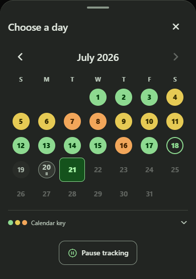
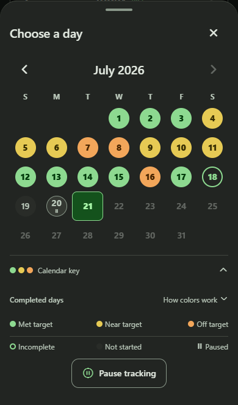
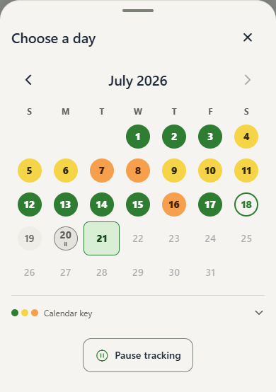
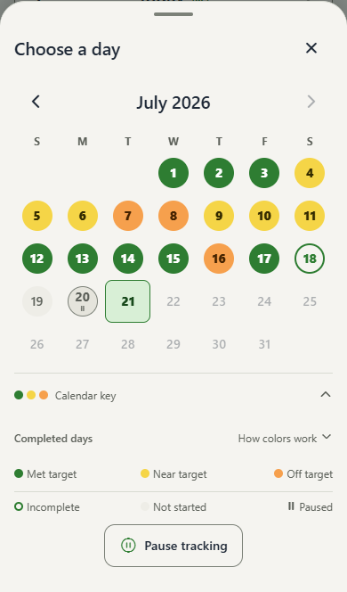
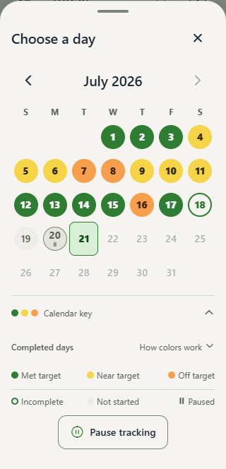
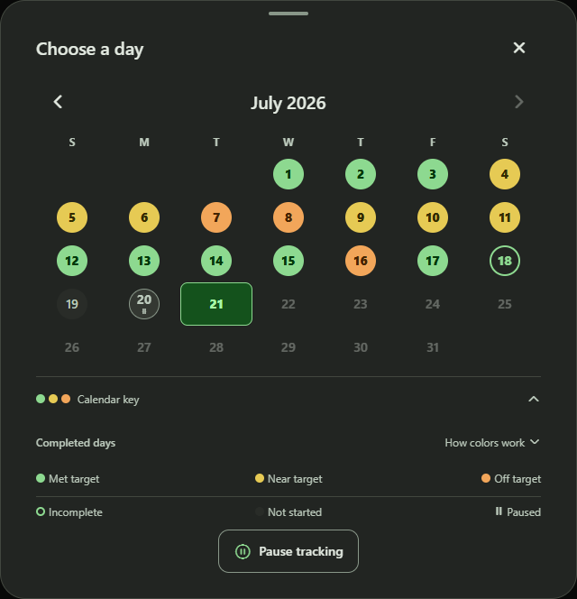

# Calendar key evidence

These are genuine browser captures of the production Expo web export using deterministic synthetic
food-day fixtures. Application and test source: `3f2cdb53bf6d13785e126b1ee7ed5de07e222da9`,
based on master `5a0cc095766e854e6fe52425bb0f0568f77254a4`. The following evidence-only commit
copies the captures without changing application code. Image and source hashes are in [manifest.json](manifest.json).
These are not design mocks or native-device captures.

| Phone, dark, collapsed | Phone, dark, expanded |
| --- | --- |
|  |  |

| Phone, light, collapsed | Phone, light, expanded |
| --- | --- |
|  |  |

| Small phone, 320px | Desktop, 1440px viewport |
| --- | --- |
|  |  |

The phone viewport is 390x844 and the compact viewport is 320x720. Calendar-modal screenshots crop
to the modal bounds. Day 17 is complete without comparison data and uses green. Day 20 is paused;
the date and glyph fit within its badge. At 200% text the badge grows to contain both:

## Reproduce and verify

Run `npm.cmd run test:web:e2e -- e2e/expo-web/completed-calendar.spec.ts`. The spec writes collapsed
and expanded captures for light/dark desktop, tablet, phone and compact-phone projects; its enlarged
text test also writes the pause-badge crop. Final result: 10 passed, 6 intentional project skips.
Assertions cover actual marker-and-label content alignment, green fallback, glyph containment,
key reset on reopening, optional explanations, completed calorie boundaries, selection, offline
history recovery and accessibility of both collapsed and expanded keys.

Mobile typecheck and production web build passed. The full mobile suite passed 234 suites / 1,288
tests before the final explicit browser `aria-expanded` addition; the final affected calendar suite
then passed all 10 tests, and typecheck passed again.

The broader checks are not green. `npm.cmd run test:ux` returned 191 passed, 5 failed, 79 skipped and
54 not run: two goal-editor checks still expect the old dialog and lack a pace-options fixture;
three offline/stale-data checks have label or snapshot mismatches. The calendar overlay and
expanded-key accessibility checks passed. The planned-pause browser run returned 54 passed,
1 failed and 9 skipped; its tablet queued-pause failure passed on isolated rerun, while the
Android-phone overdue-pause case failed intermittently across runs. These routes and pause behavior
are outside this calendar key change. No UX baseline, threshold or unrelated application behavior
was changed. Native-device execution was not performed.
